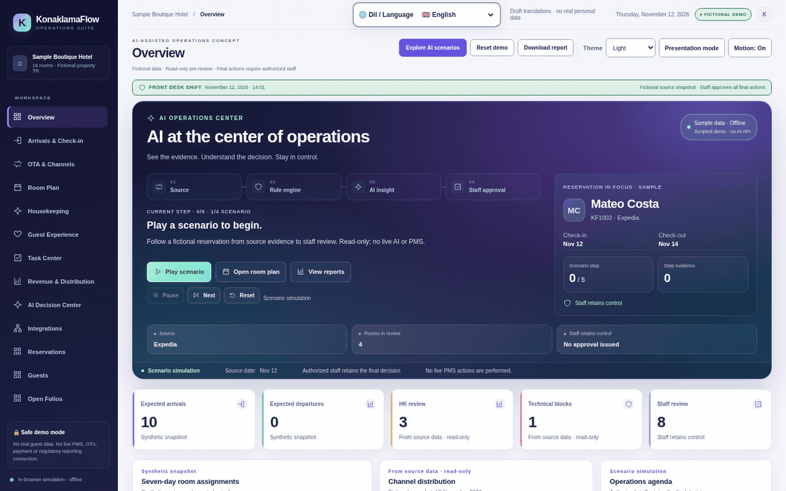
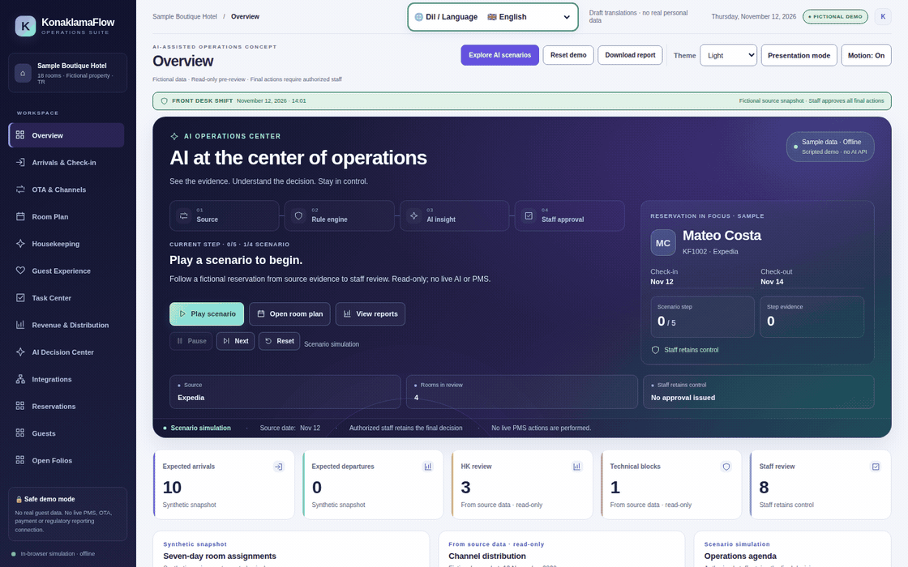
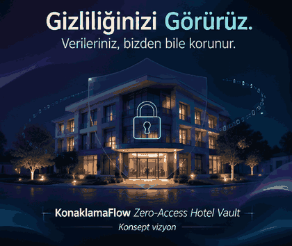

# KonaklamaFlow 🏨

**Privacy-first, MIT-licensed hotel reservation and operations review prototype for small hotels.**  
**Küçük oteller için gizlilik öncelikli, açık kaynak rezervasyon ve operasyon inceleme prototipi.**

[](https://github.com/erenariel/konaklamaflow/actions/workflows/tests.yml)
[](LICENSE)
[](pyproject.toml)
[](https://erenariel.github.io/konaklamaflow/)

## Try it / Demoyu aç

- **[Interactive fictional hotel demo / Çalışan kurgusal demo](https://erenariel.github.io/konaklamaflow/)**
- **[Visual project overview / Proje tanıtımı](https://erenariel.github.io/konaklamaflow/project-overview.html)**
- [Integrated offline HTML](demo/v04-integrated-preview.html) · [Global multilingual presentation](https://erenariel.github.io/konaklamaflow/global-presentation.html)
- [Releases](https://github.com/erenariel/konaklamaflow/releases) · [Open issues](https://github.com/erenariel/konaklamaflow/issues) · [Pull requests](https://github.com/erenariel/konaklamaflow/pulls)

> **Scope / Kapsam:** This is an **offline, fictional-data prototype**, not a deployed hotel PMS. It has **no live PMS/OTA/KBS/payment integration, no automatic check-in and no live AI-provider call**. Python rules precompute deterministic review evidence for the static browser demo. Staff authorization remains separate. **Do not enter real guest records or hotel credentials.**
>
> **Bu bir canlı otel otomasyonu değildir.** Arayüz kurgusal örneklerle rezervasyon inceleme ve personel karar sınırlarını gösterir.

## What does it do? / Ne işe yarar?

| Module / Modül | Function / İşlev |
| --- | --- |
| **Reservation review / Rezervasyon kontrolü** | Displays source-linked fictional bookings, potential conflicts and deterministic reason codes instead of unsubstantiated AI decisions |
| **Room plan / Oda planı** | Distinguishes proposed room assignments, maintenance holds, housekeeping and **unverified physical occupancy** |
| **Human review / Personel incelemesi** | Explains **source → rule → evidence field → required staff action** without approving arrivals or changing an actual PMS |
| **Operational views / İş akışları** | Navigable front-office, reservation, room, folio and report-style **demonstrations**; individual controls may still be prototypes |
| **Synthetic checks / Kurgusal testler** | Reproducible project-authored benchmark and fictional decision trace with explicit limits, not measured real-hotel accuracy |

**Browser-recording provenance:** The showcase GIFs and screenshots were captured from an earlier verified offline demo snapshot; **later copy-only clarity edits may not appear** in those recordings. They are real browser recordings of fictional data, not evidence of a live hotel integration. [Original recording and source-manifest details](PROJECT_DETAILS_2026-11-15.md).

The current integrated demo is source-validated, offline and privacy-restricted. Multilingual strings are **drafts**, not professionally verified translations. See [technical details and historical feature notes](PROJECT_DETAILS_2026-11-15.md) and [current limitations](docs/LIMITATIONS.md).

## Animated product showcase / Hareketli ürün tanıtımı

These are **real browser recordings of an earlier fictional offline demo** (not live hotel operations). **Bunlar gerçek demo ekran kayıtlarıdır; canlı otel bağlantısını veya yeni eklenen her özelliği göstermez.**

| AI review / AI inceleme | Room plan / Oda planı | Operations / Operasyon |
| :---: | :---: | :---: |
| [](docs/images/ai-command-tour.gif) | [](docs/images/roomplan-story.gif) | [](docs/images/overview-pulse.gif) |
| Source-bound review demo | Housekeeping and room status demo | Offline analytics demo |

✨ **[Explore the product interface concepts — three animated design studies](https://erenariel.github.io/konaklamaflow/project-overview.html#vizyon)** · [Design assets and media provenance](docs/VISION_SHOWCASE_TR_EN.md).

## 🔐 Privacy First — Zero-Access Vision (concept)

[](https://erenariel.github.io/konaklamaflow/privacy-campaign.html)

*Özgün arayüz vizyonu · Gerçek kullanıcı verisi içermeyen tasarım çalışması; mevcut otel güvenlik sertifikası veya canlı şifreli PMS değildir.*


**[Explore the privacy campaign / Gizlilik vizyonu tanıtımını aç](https://erenariel.github.io/konaklamaflow/privacy-campaign.html)** · [Animated schematic: authorized device → encrypted record → hotel staff authorization](https://erenariel.github.io/konaklamaflow/privacy-campaign.html#akış)

Our ambition is to build client-held-key protection for sensitive guest records: **a software vendor should not automatically possess guest decryption keys.** Today this is a research proposal with a **synthetic browser-only crypto lab**, **not** an audited, certified, or live encrypted hotel PMS. Future certification artwork is explicitly a concept, not an issued credential. No unique-in-the-world or absolute data-breach claims are made.

## Zero-Access Hotel Vault — privacy architecture research 🔐

A future **Proton-inspired, client-held-key encryption model** is under design for sensitive hotel guest records. A standalone [**synthetic-only browser encryption lab**](https://erenariel.github.io/konaklamaflow/privacy-vault-lab.html) demonstrates locally encrypted and decrypted **fake data** using standard Web Crypto AES-GCM; it has **no backend, real users, staff key-sharing, recovery or live PMS connection**. It is **not an audited zero-knowledge hotel product** and cannot establish that a future vendor can never see plaintext. [Technical threat model and development gates (TR/EN)](docs/ZERO_ACCESS_HOTEL_VAULT_TR_EN.md).

## Hotel-operator evidence / İmzalı ve kaşeli değerlendirme

On **15 November 2026**, a reviewer affiliated with this project and identifying as an **Asmalı Hotel front-office representative** submitted a **dated, signed and property-stamped first-party operator worksheet** about the fictional offline demo. The reviewer reports evaluating it in a hotel setting; this location and authority have **not been independently authenticated**.

**Four topics have handwritten observations; only the reservation-conflict scenario is explicitly checked “Pass”.** Room plan, night-shift handover and language/usability have written feedback but their result boxes are **unmarked**. Incomplete translations were noted. The original form still says **DRAFT / NOT YET CONFIRMED** and its declaration checkboxes remain unmarked.

- **[Inspect the actual privacy-redacted paper scans (EN/TR PDF)](docs/evidence/KonaklamaFlow_Operator_Review_PUBLIC_REDACTED_TR_EN_2026-11-15.pdf)**
- [English operator evidence summary](docs/OPERATOR_FIRST_PARTY_REVIEW_2026-11-15.md) · [Bilingual privacy/legal disclosure](docs/PUBLIC_EVIDENCE_DISCLOSURE_TR_EN.md) · [Consolidated evidence PR #76](https://github.com/erenariel/konaklamaflow/pull/76)

**Evidence status:** Documented, signed and stamped **first-party, maintainer-affiliated self-assessment**, **not** independent hotel certification, government approval, live hotel-system testing, or proof of customer adoption. Original signature specimens and private stamp details are not publicly uploaded.

## Run locally / Yerel kullanım

**Requirements:** Python 3.11+; offline synthetic fixtures only.

```bash
git clone https://github.com/erenariel/konaklamaflow.git
cd konaklamaflow
python -m pip install .
python -m konaklamaflow examples/demo.json --as-of 2026-11-12
python -m konaklamaflow.ops_cli examples/operations-demo.json --as-of 2026-11-12 --at-time 14:01
```

To inspect the standalone demo without Python, open [`demo/v04-integrated-preview.html`](demo/v04-integrated-preview.html). CLI inputs and reports must not contain personal data; write reports to a different file than the input.

## Engineering evidence / Teknik testler

- [GitHub Actions — automated tests](https://github.com/erenariel/konaklamaflow/actions/workflows/tests.yml): Python 3.11–3.13 unit tests and Chromium browser checks.
- [Main-run CI evidence (15 Nov 2026)](https://github.com/erenariel/konaklamaflow/actions/runs/43682701510) · [Successful demo workflow](https://github.com/erenariel/konaklamaflow/actions/runs/43682944588)
- [Merged integrated offline preview PR #67](https://github.com/erenariel/konaklamaflow/pull/67)
- [Synthetic benchmark PR #51](https://github.com/erenariel/konaklamaflow/pull/51) and [scorecard PR #58](https://github.com/erenariel/konaklamaflow/pull/58): **7/10** project-authored cases were evaluated; this is **not** a real-world accuracy percentage.
- [Architecture/limits](docs/LIMITATIONS.md) · [Release gate](docs/RELEASE_GATE_TR.md) · [Security policy](SECURITY.md)

## Releases, contributions and roadmap / Sürümler ve katkı

**Version tracks are separate:** the browser **v0.5.x fictional demo** is not the same release as the Python distribution in [`pyproject.toml`](pyproject.toml), currently **`0.2.0rc1`**. A demo tag or GitHub Release does **not** imply a corresponding PyPI package was published. [Release strategy and metrics](docs/RELEASE_STRATEGY_TR_EN.md).

The immediate roadmap includes stronger interactive coverage, source-bound operator feedback, offline distribution, translation review and **future, separately authorized** integration design. See [Issues](https://github.com/erenariel/konaklamaflow/issues) and [Changelog](CHANGELOG.md). Do not infer feature completion from an open pull request.

Contributions and feedback are welcome: [CONTRIBUTING.md](CONTRIBUTING.md) · [Fictional-only operator feedback guide](docs/OPERATOR_FEEDBACK_TR_EN.md). Please never include real guest names, passports, hotel system exports, credentials or operational secrets.

**Historical comprehensive README:** [Full technical/project detail snapshot (15 Nov 2026)](PROJECT_DETAILS_2026-11-15.md). All existing detailed explanations remain available there.
