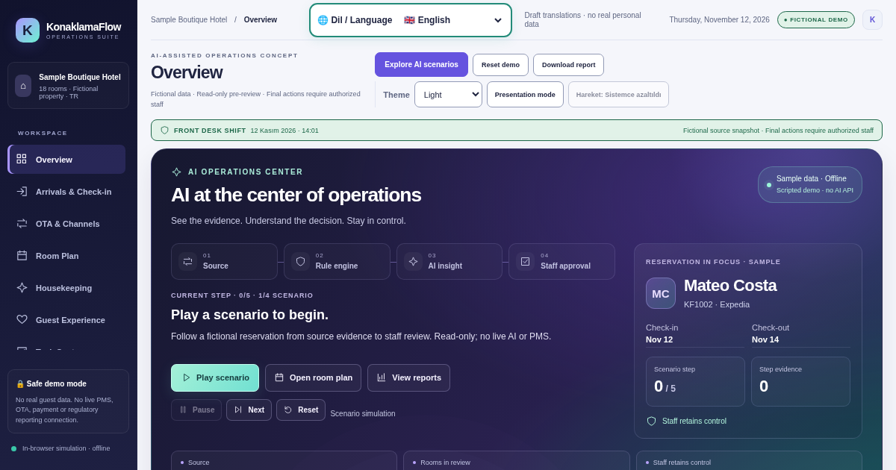
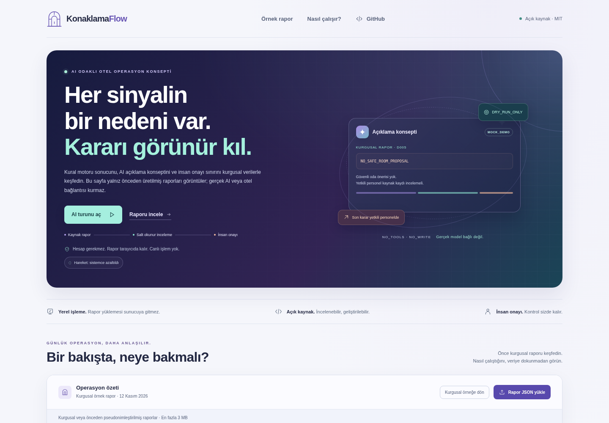

# KonaklamaFlow

**Privacy-first, open-source reservation operations reviewer for small hotels in Türkiye and beyond.**

[](https://erenariel.github.io/konaklamaflow/)

**[Try the fictional demo / Kurgusal demoyu aç](https://erenariel.github.io/konaklamaflow/)** · [Latest release](https://github.com/erenariel/konaklamaflow/releases/latest)

The demo starts with fictional data. Selected report files are processed in your browser; download `demo/viewer.html` for fully offline use.

[](https://github.com/erenariel/konaklamaflow/actions/workflows/tests.yml) [](LICENSE) [](CHANGELOG.md)

> **Project status (2026-11-12):** Runnable developer prototype, not a certified PMS, hotel management suite, production booking engine, or KBS integration. No real customer deployments or third-party integrations are claimed.

**TR:** KonaklamaFlow, küçük ve butik otellerin rezervasyon ve oda blokajı kontrollerini kurgusal veya önceden pseudonimleştirilmiş verilerle deneyebilmesi için oluşturulmuş, açık kaynaklı bir *ön kontrol / karar destek motorudur*. Herhangi bir otel sistemine kendiliğinden giriş yapmaz. **Gerçek PMS üzerinde işlem yapmaz, misafire söz vermez ve KBS bildirimi göndermez.**

**EN:** A deterministic, provider-neutral dry-run reviewer: ingest pseudonymized reservations and room availability, inspect possible conflicts, suggest safe room choices, and print a next-day arrival checklist. Every proposed action needs a human decision in the authorized property-management system.

## Problems we are solving / Ne işe yarıyor?

- **Overbooking / duplicate booking review:** overlapping confirmed room assignments, repeated OTA references, incompatible categories.
- **Tomorrow's arrival briefing:** generate a simple queue for front-desk and housekeeping teams.
- **Room block recommendations:** match sold category and bed requirement against real available inventory, avoiding maintenance periods and overlapping bookings. These are proposals **only**.
- **Cancellation review:** cancelled bookings with a previously held room are highlighted for manual verification; never auto-remove a booking.
- **Base price consistency:** identify mismatches between a given nightly base price and provided base total, without inventing tax or commission rules.
- **Privacy by default:** do not accept guest names, phone numbers, passports, identity numbers, email addresses, payment cards or access tokens in the input schema.

## Quick start (Python 3.11+)

No external runtime libraries, no account, no network calls:

```bash
# from the cloned project root
python -m konaklamaflow examples/demo.json --as-of 2026-11-12 --output report.json
python -m unittest discover -s tests -v
```

Install locally if desired:

```bash
python -m pip install -e .
konaklamaflow examples/demo.json --as-of 2026-11-12
```

The demo has **five fictional rooms and five fictional reservations**. The initial report finds one proposed room, one inventory conflict, a cancellation hold to review, and a base-price mismatch. All amounts, room references and dates in the sample are fictional.

### Output (sample)

```json
{
  "mode": "DRY_RUN_ONLY",
  "summary": {
    "rooms": 5,
    "reservations": 5,
    "critical_alerts": 1,
    "review_alerts": 2,
    "room_proposals": 1,
    "tomorrow_arrivals": 3
  }
}
```

This abbreviated example only displays a subset of the complete report fields. The full sample output is under `examples/demo-report.json`.

## Offline visual viewer / Görsel panel



*Fictional demonstration data only. Room proposals require human review.*

Open `demo/viewer.html` directly in your browser to explore the **fictional** report. The viewer offers a mobile-friendly presentation, Turkish issue explanations, critical-first ordering, and filters for critical and review alerts. Original report details remain available under **Rapor ayrıntısı**. It supports schema 1.0 dry-run reports up to 3 MB; malformed files leave the last valid report on screen. Errors are shown inline, the file picker supports keyboard input, and **Kurgusal örneğe dön** resets the demo. For your own pseudonymized results, select the generated `report.json` file with **Rapor JSON yükle**. The viewer contains no CDNs, telemetry, report uploads, storage or external JavaScript; it only renders the local file you select. **This is a report viewer, not a browser-based PMS.**

## Security, real-world use, limitations

- The demo intentionally contains no credentials, customer identity data or any hotel identifiers. **Do not copy real PMS exports into a public repository, CI logs, issue comments or sample files.**
- Real integration requires vendor authorization, written property authorization, an API agreement where appropriate, security review, documented consent/legal basis, and a protected runtime. Import normalization and PII minimization must happen *before* this engine.
- KBS (police accommodation notifications), official registries, tax/financial records, accounting and regulatory obligations are **out of scope**. No field substitution, KBS workarounds, credential harvesting, login automation or guest identity handling is implemented.
- Property-specific rules (room upgrades, twin requests, cancellation holds, local taxes) must be reviewed by the operator. No output should be treated as a final booking decision.
- There is no telemetry, AI provider API call, database or scheduler in the review engine. The optional hosted demo loads its static page from GitHub Pages; selected report files are processed locally in the browser. Download the viewer for fully offline use.

See [Security](SECURITY.md), [Input Specification](docs/INPUT_SPEC.md), [Architecture](docs/ARCHITECTURE.md), and [Known Limitations](docs/LIMITATIONS.md).

## Roadmap — practical, measurable milestones

1. **Current prototype:** validated pseudonymized JSON, deterministic rules, engine/browser regression tests, CLI, and fictional demonstrations. Candidate branch capabilities are described below.
2. **v0.2:** opt-in local dashboard, import adapter specification, immutable audit format, more test scenarios for split stays and mixed capacity.
3. **v0.3:** community-driven integrations *only* for vendor-supported APIs, with sandbox test suites and explicit approval; multi-property namespace isolation.
4. **v1.0 goal:** stable schema, upgrade policies, security review, opt-in pilot documentation, observability and maintainer governance. We do **not** claim these features exist today.

Read the [maintenance roadmap](docs/MAINTAINER_PLAN.md), [testing guide](docs/TESTING.md) and [issue templates](.github/ISSUE_TEMPLATE).

## Contributing / Katkı

PRs, reproducible bug reports, documentation improvements, and **synthetic** test fixtures are welcome. See [CONTRIBUTING.md](CONTRIBUTING.md) and [CODE_OF_CONDUCT.md](CODE_OF_CONDUCT.md). Never include real guest data in an issue.

## License and provenance

[MIT](LICENSE). Initially developed with AI assistance under human project direction; tests and claims must be reviewed before publishing. This project is independent and unaffiliated with any specific PMS, channel manager, hotel brand, OTA, government service or AI platform. It was inspired by real-world hospitality operation challenges, not by exporting proprietary systems or customer records.

## Front Desk Operations Prototype (v0.2.0rc1)

This development branch adds a privacy-first **check-in readiness reviewer**, not a live check-in service. It combines pseudonymous reservation references, housekeeping and technical holds, arrival-time rules and authorized review signals. A second AI can receive an expiring **read-only** task handoff; it cannot change reservations, send messages, collect payment or submit KBS notifications.

- [Offline operations cockpit](demo/operations.html) — fictional, browser-local viewer (will be published at `/operations.html` on Pages after review and merge).
- [Operations product blueprint](docs/PRODUCT_BLUEPRINT_TR.md)
- [Second-AI handoff protocol](docs/AI_AGENT_PROTOCOL_TR.md)
- [Market and competitor research](docs/COMPETITIVE_RESEARCH_TR.md)
- [Go-to-market strategy](docs/MARKETING_GO_TO_MARKET_TR.md)
- [Release quality gates](docs/RELEASE_QUALITY_CHECKLIST_TR.md)

Run locally:

```bash
python -m konaklamaflow.ops_cli examples/operations-demo.json --as-of 2026-11-12 --at-time 14:01 --output ops-report.json
python -m unittest discover -s tests -v
```

**Limitations:** no real PMS integration, no customer identity data, no official registration, no automatic hotel check-in. AI can make mistakes; every critical decision requires fresh authoritative verification and a human operator.

## Hotel operations suite — v0.3 development preview

The `feat/hotel-operations-suite-v03` branch extends the unmerged v0.2 work in PR #2. Its review PR targets that development branch; neither PR has been merged into `main`. **v0.3 is a schema/UI development preview, not a published package release.** Existing reservation, operations and AI-review APIs remain available; the distribution remains a release candidate.

Open [demo/hotel-suite.html](demo/hotel-suite.html) locally for ten fictional views: front desk, arrivals, OTA reconciliation, room plan, housekeeping/engineering, guest-request drafts, department tasks, reservation totals, AI review and the planned integration map. This preview has no external requests, telemetry or browser storage. No live provider, PMS, payment, identity or KBS connection is enabled. It has not been deployed by this branch.

```bash
python -m konaklamaflow.experience_cli examples/fictional-hotel.json
python scripts/generate_suite_demo.py --check
python -m unittest discover -s tests -v
# With the optional browser extra and Playwright Chromium installed:
python -m unittest discover -s tests/browser -v
```

The suite adapts its schema to the existing v0.2 rule engine. Capacity, bed/amenity requests, channel references, task holds and currency-separated reservation totals extend those common checks. The browser renders the Python-generated report; any local housekeeping/task/event simulation invalidates readiness and export until reset. It does not recalculate an independent check-in decision in JavaScript.

Booking.com, Expedia, Trip.com/Ctrip and channel-manager labels describe **synthetic source reconciliation**, not connected accounts. Amounts use decimal strings; reservation totals are not daily revenue, cash receipts or a reconciled folio. The two-assistant contract exposes only opaque, expiring review references and rechecks the current trusted snapshot. Hashes and TTL do not authenticate an operator or authorize an action. Durable audit, RBAC/MFA, operation idempotency and human approval in a real PMS remain future architecture.

Read the [schema and trust contract](docs/V03_SCHEMA_TR.md), [integration record](docs/V03_INTEGRATION_REPORT_TR.md), [official-source research](docs/RESEARCH_MATRIX_TR.md), [threat model](docs/GUVENLIK_TEHDIT_MODELI_TR.md) and [phased roadmap](docs/GELISTIRME_YOL_HARITASI_TR.md). The supplied [integration instructions](docs/CODEX_INTEGRATION_TR.md) are preserved. No adoption, time-saving, vendor partnership or production-performance result is claimed.
