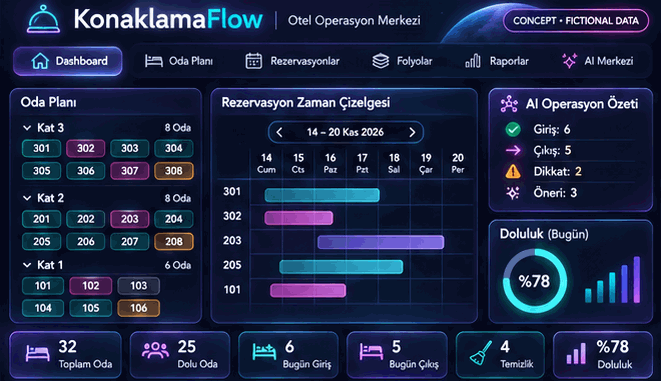
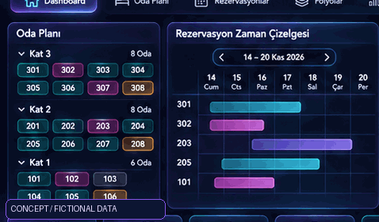

# Aurora motion concepts — KonaklamaFlow

> **DESIGN CONCEPT / FICTIONAL DATA ONLY — NOT A CAPTURE OF THE RUNNING APPLICATION.**
>
> **TR:** Bu görseller yeni nesil otel operasyon merkezi için **üretilmiş kavramsal animasyonlardır**. Çalışan yazılım, gerçek PMS bağlantısı, AI çıkarımı, gerçek doluluk, kasa veya folyo sonucu göstermezler. Görsellerdeki sayılar tamamen kurgusaldır ve mevcut kanonik demo verisiyle doğrulanmış değildir.

## 1. Operations center / Operasyon merkezi

## 2. Rooms and timeline / Oda planı ve rezervasyon çizelgesi

## Origin and intended use

- These original generated visuals express the **future visual direction** for [Issue #37](https://github.com/erenariel/konaklamaflow/issues/37): room rack, timeline, guest list, reports, folios and AI-evidence presentation.
- Displayed room identifiers, dates, totals, percentages and AI notices **must not be treated as test results or operational truth**. Real implementation must be bound to the Python-validated fictional canonical snapshot and explicit source state.
- **No proprietary PMS screens, real hotel data, guest records, vendor branding or private screenshots** were incorporated in these files.
- The motion is cosmetic. For the real UI, respect motion-off, `prefers-reduced-motion`, keyboard access, small viewports, RTL, localization and contrast.
- The real application's source-bound browser GIFs stay separately under `docs/images/`; **do not replace them with these concepts** or update their provenance manifests to claim these generated images are captures.
- This PR deliberately changes **documentation/media only**. It neither completes Issue #37 nor modifies/merges [PR #39](https://github.com/erenariel/konaklamaflow/pull/39).

## Implementation idea / Uygulama sırası

1. Finish independent review of PR #39 (shared canonical source).
2. Build floor-based graphical room cards and date timeline on **real synthetic source data**, not the artwork's placeholder numbers.
3. Add evidence-linked AI highlighting; never imply live model execution unless there is a real authorized adapter.
4. Preserve existing Aurora identity instead of copying Sistem Otel or any other vendor UI.
